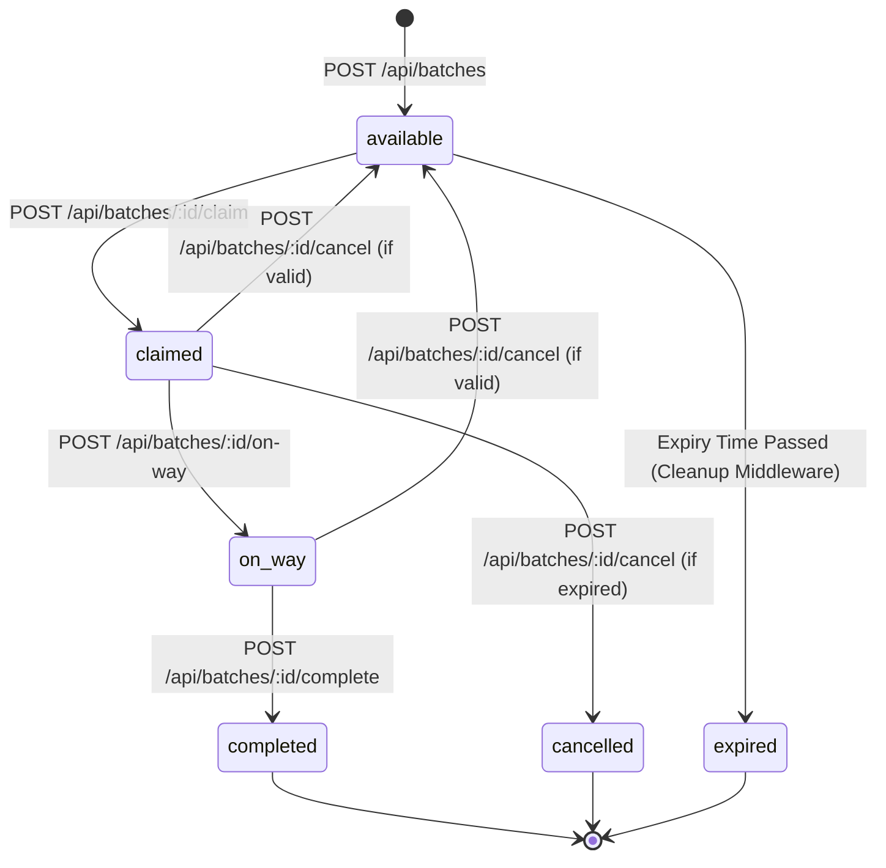

# Food Left at Closing Time 🍲⏰

> **SE 331 Software Engineering Capstone Project**  
> Collaborative Group Project for 3 Developers

A specialized full-stack platform designed to eliminate food waste by connecting restaurants, bakeries, cafes, and supermarkets with local charities, shelters, and community members. Food businesses can quickly list edible surplus batches right before closing hours, allowing beneficiaries and volunteer couriers to claim items, signal pickup in real time, and confirm delivery before food spoils.

---

## Table of Contents
1. [Project Overview](#project-overview)
2. [Repository Architecture](#repository-architecture)
3. [Setup & Installation Instructions](#setup--installation-instructions)
   - [Prerequisites](#prerequisites)
   - [Backend Setup](#backend-setup)
   - [Frontend Setup](#frontend-setup)
4. [3-Member Team Branch & File Ownership Rules](#3-member-team-branch--file-ownership-rules)
   - [Branch Naming & Responsibilities](#branch-naming--responsibilities)
   - [File Ownership Matrix](#file-ownership-matrix)
   - [Git Collaboration & Merge Guidelines](#git-collaboration--merge-guidelines)
5. [Exact REST API Contract](#exact-rest-api-contract)
   - [POST /api/auth/register](#1-post-apiauthregister)
   - [POST /api/auth/login](#2-post-apiauthlogin)
   - [POST /api/batches](#3-post-apibatches)
   - [GET /api/batches](#4-get-apibatches)
   - [POST /api/batches/:id/claim](#5-post-apibatchesidclaim)
   - [POST /api/batches/:id/on-way](#6-post-apibatchesidon-way)
   - [POST /api/batches/:id/cancel](#7-post-apibatchesidcancel)
   - [POST /api/batches/:id/complete](#8-post-apibatchesidcomplete)
6. [State Machine Lifecycle](#state-machine-lifecycle)

---

## Project Overview

Every evening, food businesses discard substantial amounts of wholesome, freshly prepared food simply because their retail operating hours have concluded. **Food Left at Closing Time** bridges this operational gap by streamlining:

- **Rapid Batch Listing:** Donors post remaining food with photos, categories, dietary flags, packaging info, and a closing pickup window.
- **Urgent Claim Engine:** Real-time claiming prevents race conditions and ensures items are claimed before closing.
- **Live Transit Status:** Claimers can notify donors that they are "on the way" with estimated arrival times.
- **Automated Expiry Cleanup:** Built-in sweepers monitor time limits and automatically retire uncollected batches.
- **Verification & Handover:** Secure completion mechanisms guarantee accountability and audit tracking.

---

## Repository Architecture

```text
CapstonProject/
├── .gitignore                     # Root gitignore (node_modules, .env, *.sqlite, dist)
├── README.md                      # Project master documentation & API specification
│
├── backend/                       # Express.js REST API & SQLite Database
│   ├── .env.example               # Backend environment variable template
│   ├── package.json               # Backend dependencies & runtime scripts
│   ├── server.js                  # Main Express application entry point
│   ├── seed.js                    # Database schema initialization & mock data [Member 1]
│   ├── db/
│   │   └── database.js            # SQLite database initialization & table setup
│   ├── routes/
│   │   ├── auth.js                # Auth endpoints (register, login stubs) [Member 1]
│   │   └── batches.js             # Batch CRUD & state transitions stubs [Member 2]
│   ├── middleware/
│   │   ├── authMiddleware.js      # JWT authentication middleware { id, role }
│   │   └── cleanup.js             # Expired batch background cleaner hook [Member 2]
│   ├── services/
│   │   └── matching.js            # Donor-to-recipient matching engine [Member 2]
│   └── utils/
│       └── parser.js              # Payload parsing & sanitization helpers [Member 1]
│
└── frontend/                      # React SPA (Vite + Tailwind CSS)
    ├── .env.example               # Frontend environment template
    ├── index.html                 # HTML entry document
    ├── package.json               # Frontend dependencies (react-router-dom, axios, tailwindcss)
    ├── vite.config.js             # Vite config with /api proxy to http://localhost:5000
    ├── tailwind.config.js         # Tailwind CSS styling configuration
    ├── postcss.config.js          # PostCSS configuration with Tailwind & Autoprefixer
    └── src/
        ├── App.jsx                # Protected role-based routing (RESTAURANT / SHELTER)
        ├── main.jsx               # React DOM bootstrapping with Tailwind styles
        ├── index.css              # Tailwind base, components, and utilities
        ├── api/                   # API integration services [Member 3]
        │   ├── client.js          # Pre-configured Axios instance with JWT Bearer interceptor
        │   ├── auth.js            # Auth API callers (login, register)
        │   └── batches.js         # Batch API callers (CRUD & status transitions)
        ├── context/
        │   └── AuthContext.jsx    # Auth state provider (user, token, login, logout)
        └── pages/                 # User interface pages & views [Member 3]
            ├── Auth.jsx           # Login & role-based registration view
            ├── RestaurantDash.jsx # Tanvir's Surplus Posting Dashboard
            └── ShelterFeed.jsx    # Shelter Eligible Batches & Handover PIN entry
```

---

## Setup & Installation Instructions

### Prerequisites
- **Node.js**: `v18.x` or higher (verify via `node -v`)
- **npm**: `v9.x` or higher (verify via `npm -v`)
- **Git**: Installed and configured with your GitHub credentials

---

### Backend Setup

1. **Navigate to the backend directory:**
   ```bash
   cd backend
   ```

2. **Install dependencies:**
   ```bash
   npm install
   ```

3. **Configure environment variables:**
   ```bash
   # Copy the sample environment file
   cp .env.example .env
   ```
   *Default `.env` values:*
   ```env
   PORT=5000
   NODE_ENV=development
   JWT_SECRET=super_secret_jwt_key_change_in_production
   DB_PATH=./database.sqlite
   CORS_ORIGIN=http://localhost:5173
   BATCH_CLEANUP_INTERVAL_MS=300000
   ```

4. **Initialize and seed the database:**
   ```bash
   npm run seed
   ```

5. **Start the backend development server:**
   ```bash
   npm run dev
   ```
   The backend will start at: `http://localhost:5000`  
   Health check endpoint: `http://localhost:5000/api/health`

---

### Frontend Setup

1. **Navigate to the frontend directory:**
   ```bash
   cd frontend
   ```

2. **Install dependencies:**
   ```bash
   npm install
   ```

3. **Configure environment variables:**
   ```bash
   # Copy the sample environment file
   cp .env.example .env
   ```
   *Default `.env` values:*
   ```env
   VITE_API_BASE_URL=http://localhost:5000/api
   ```

4. **Start the frontend development server:**
   ```bash
   npm run dev
   ```
   The application UI will be accessible at: `http://localhost:5173`

5. **Build for production:**
   ```bash
   npm run build
   ```

---

## 3-Member Team Branch & File Ownership Rules

To prevent code collisions and git merge conflicts in our 3-developer team, we enforce strict **file ownership boundaries** and **dedicated feature branches**.

### Branch Naming & Responsibilities

| Role | Branch Name | Developer | Core Domain Focus |
| :--- | :--- | :--- | :--- |
| **Member 1** | `feat/backend-core` | Developer 1 | Authentication, user tokens, input parser utilities, database schema, and test seeds. |
| **Member 2** | `feat/claim-engine` | Developer 2 | Food batch state machine, claiming workflow, expiration background sweep, matching algorithms. |
| **Member 3** | `feat/frontend-ui` | Developer 3 | Client UI pages, responsive layout, form validations, and API communication layer. |

---

### File Ownership Matrix

```
┌───────────────────────────────┬────────────────────────────────────────────────────────┐
│ Branch / Member               │ Exclusive File Ownership                               │
├───────────────────────────────┼────────────────────────────────────────────────────────┤
│ Member 1                      │ • /backend/routes/auth.js                              │
│ feat/backend-core             │ • /backend/utils/parser.js                             │
│                               │ • /backend/seed.js                                     │
├───────────────────────────────┼────────────────────────────────────────────────────────┤
│ Member 2                      │ • /backend/routes/batches.js                           │
│ feat/claim-engine             │ • /backend/middleware/cleanup.js                       │
│                               │ • /backend/services/matching.js                        │
├───────────────────────────────┼────────────────────────────────────────────────────────┤
│ Member 3                      │ • /frontend/src/pages/* (All UI views)                 │
│ feat/frontend-ui              │ • /frontend/src/api/* (All API client integrations)    │
└───────────────────────────────┴────────────────────────────────────────────────────────┘
```

> ⚠️ **RULE**: Never modify files owned by another member without explicit verbal confirmation and a peer code review.

---

### Git Collaboration & Merge Guidelines

1. **Branch Creation:**  
   Every developer starts their feature branch from the latest `main`:
   ```bash
   git checkout main
   git pull origin main
   git checkout -b <your-branch-name>
   ```

2. **Commit Conventions:**  
   Write clean, descriptive commit messages matching conventional commits:
   - `feat: add password hashing in auth route`
   - `fix: handle expired batch transition on claim`
   - `ui: style batch card status pills`

3. **Pull Request (PR) Policy:**
   - **No direct commits to `main`**. All code changes must go through a GitHub Pull Request.
   - At least **1 peer review approval** is required before merging.
   - Run tests and verify both backend and frontend compile locally before creating a PR.
   - Always pull latest `main` into your feature branch before requesting review:
     ```bash
     git checkout main
     git pull origin main
     git checkout <your-branch-name>
     git merge main
     ```

---

## Exact REST API Contract

Base URL: `http://localhost:5000/api`

---

### 1. POST /api/auth/register

Registers a new user (donor business, recipient shelter/charity, or volunteer courier).

- **Method:** `POST`
- **URL:** `/api/auth/register`
- **Authentication:** Public (None)
- **Headers:** `Content-Type: application/json`

#### Request JSON
```json
{
  "name": "Downtown Bakery & Cafe",
  "email": "contact@downtownbakery.com",
  "password": "SecurePassword123!",
  "role": "donor",
  "phone": "+1-555-0199",
  "organization": "Downtown Bakery LLC"
}
```
*Field Specifications:*
- `name` *(string, required)*: Full name or business name.
- `email` *(string, required)*: Valid unique email address.
- `password` *(string, required)*: Plaintext password (minimum 8 chars).
- `role` *(string, required)*: One of `donor`, `recipient`, `volunteer`.
- `phone` *(string, optional)*: Contact telephone number.
- `organization` *(string, optional)*: Registered company / charity entity.

#### Response JSON
- **Success (201 Created):**
```json
{
  "message": "User registered successfully",
  "user": {
    "id": "usr_948194821",
    "name": "Downtown Bakery & Cafe",
    "email": "contact@downtownbakery.com",
    "role": "donor",
    "phone": "+1-555-0199",
    "organization": "Downtown Bakery LLC",
    "createdAt": "2026-11-23T11:30:00.000Z"
  },
  "token": "eyJhbGciOiJIUzI1NiIsInR5cCI6IkpXVCJ9.eyJpZCI6InVzcl85NDgxOTQ4MjEiLCJyb2xlIjoiZG9ub3IifQ..."
}
```

- **Error (400 Bad Request):**
```json
{
  "error": "Missing required fields: name, email, password, and role are mandatory."
}
```

- **Error (409 Conflict):**
```json
{
  "error": "User with this email already exists."
}
```

---

### 2. POST /api/auth/login

Authenticates an existing user and returns a signed JWT bearer token.

- **Method:** `POST`
- **URL:** `/api/auth/login`
- **Authentication:** Public (None)
- **Headers:** `Content-Type: application/json`

#### Request JSON
```json
{
  "email": "contact@downtownbakery.com",
  "password": "SecurePassword123!"
}
```

#### Response JSON
- **Success (200 OK):**
```json
{
  "message": "Login successful",
  "token": "eyJhbGciOiJIUzI1NiIsInR5cCI6IkpXVCJ9.eyJpZCI6InVzcl85NDgxOTQ4MjEiLCJyb2xlIjoiZG9ub3IifQ...",
  "user": {
    "id": "usr_948194821",
    "name": "Downtown Bakery & Cafe",
    "email": "contact@downtownbakery.com",
    "role": "donor",
    "organization": "Downtown Bakery LLC"
  }
}
```

- **Error (401 Unauthorized):**
```json
{
  "error": "Invalid email or password."
}
```

---

### 3. POST /api/batches

Allows a food business (donor) to create a surplus food batch available for pickup at closing time.

- **Method:** `POST`
- **URL:** `/api/batches`
- **Authentication:** Bearer Token (`Authorization: Bearer <token>`)
- **Headers:**
  - `Content-Type: application/json`
  - `Authorization: Bearer <token>`

#### Request JSON
```json
{
  "title": "Fresh Pastries & Whole Wheat Loaves",
  "description": "12 croissants, 8 cinnamon rolls, and 5 fresh sourdough loaves baked this morning. Boxed and ready for pickup.",
  "category": "bakery",
  "quantity": 25,
  "unit": "portions",
  "expiryTime": "2026-11-23T21:00:00.000Z",
  "pickupAddress": "124 Market Street, Suite 100, City Center",
  "allergens": ["gluten", "dairy"],
  "dietaryFlags": ["vegetarian"]
}
```
*Field Specifications:*
- `title` *(string, required)*: Brief headline of the surplus food.
- `description` *(string, optional)*: Details about packaging, heating instructions, or specific contents.
- `category` *(string, required)*: One of `bakery`, `prepared_meals`, `produce`, `dairy`, `groceries`, `other`.
- `quantity` *(number, required)*: Positive integer amount.
- `unit` *(string, required)*: Unit denomination (`items`, `portions`, `boxes`, `kg`).
- `expiryTime` *(ISO8601 string, required)*: Closing/cutoff time after which food cannot be collected.
- `pickupAddress` *(string, required)*: Location where items can be picked up.
- `allergens` *(array of strings, optional)*: e.g. `["nuts", "dairy"]`.
- `dietaryFlags` *(array of strings, optional)*: e.g. `["halal", "vegan"]`.

#### Response JSON
- **Success (201 Created):**
```json
{
  "message": "Food batch posted successfully",
  "batch": {
    "id": "batch_820491823",
    "title": "Fresh Pastries & Whole Wheat Loaves",
    "description": "12 croissants, 8 cinnamon rolls, and 5 fresh sourdough loaves baked this morning. Boxed and ready for pickup.",
    "category": "bakery",
    "quantity": 25,
    "unit": "portions",
    "status": "available",
    "donorId": "usr_948194821",
    "claimedBy": null,
    "claimedAt": null,
    "pickupAddress": "124 Market Street, Suite 100, City Center",
    "allergens": ["gluten", "dairy"],
    "dietaryFlags": ["vegetarian"],
    "expiryTime": "2026-11-23T21:00:00.000Z",
    "createdAt": "2026-11-23T18:30:00.000Z",
    "updatedAt": "2026-11-23T18:30:00.000Z"
  }
}
```

- **Error (400 Bad Request):**
```json
{
  "error": "Missing required batch fields: title, quantity, expiryTime, and pickupAddress are required."
}
```

- **Error (401 Unauthorized):**
```json
{
  "error": "Authentication token missing or invalid."
}
```

---

### 4. GET /api/batches

Fetches a list of food batches with optional query parameter filtering.

- **Method:** `GET`
- **URL:** `/api/batches`
- **Authentication:** Public or Authenticated
- **Query Parameters:**
  - `status` *(string, optional)*: Filter by batch state (`available`, `claimed`, `on-way`, `completed`, `expired`).
  - `category` *(string, optional)*: Filter by food category (`bakery`, `produce`, etc.).
  - `donorId` *(string, optional)*: Filter by donor user ID.

#### Request Example
```http
GET /api/batches?status=available&category=bakery HTTP/1.1
Host: localhost:5000
```

#### Response JSON
- **Success (200 OK):**
```json
{
  "total": 2,
  "batches": [
    {
      "id": "batch_820491823",
      "title": "Fresh Pastries & Whole Wheat Loaves",
      "description": "12 croissants, 8 cinnamon rolls, and 5 fresh sourdough loaves.",
      "category": "bakery",
      "quantity": 25,
      "unit": "portions",
      "status": "available",
      "donorId": "usr_948194821",
      "claimedBy": null,
      "claimedAt": null,
      "pickupAddress": "124 Market Street, Suite 100, City Center",
      "allergens": ["gluten", "dairy"],
      "dietaryFlags": ["vegetarian"],
      "expiryTime": "2026-11-23T21:00:00.000Z",
      "createdAt": "2026-11-23T18:30:00.000Z",
      "updatedAt": "2026-11-23T18:30:00.000Z"
    },
    {
      "id": "batch_101",
      "title": "Artisan Sourdough and Baguettes",
      "description": "15 freshly baked sourdough loaves and 10 baguettes remaining after closing.",
      "category": "bakery",
      "quantity": 25,
      "unit": "loaves",
      "status": "available",
      "donorId": "usr_donor_1",
      "claimedBy": null,
      "claimedAt": null,
      "pickupAddress": "124 Market St, City Center",
      "allergens": ["gluten"],
      "dietaryFlags": ["vegan"],
      "expiryTime": "2026-11-23T22:00:00.000Z",
      "createdAt": "2026-11-23T18:00:00.000Z",
      "updatedAt": "2026-11-23T18:00:00.000Z"
    }
  ]
}
```

---

### 5. POST /api/batches/:id/claim

Allows a recipient or volunteer to reserve an available food batch before pickup.

- **Method:** `POST`
- **URL:** `/api/batches/:id/claim`
- **Authentication:** Bearer Token (`Authorization: Bearer <token>`)
- **Headers:**
  - `Content-Type: application/json`
  - `Authorization: Bearer <token>`
- **URL Parameters:** `id` (e.g. `batch_820491823`)

#### Request JSON
```json
{
  "claimNotes": "Volunteer driver dispatched from Westside community center.",
  "estimatedPickupTime": "2026-11-23T20:15:00.000Z"
}
```

#### Response JSON
- **Success (200 OK):**
```json
{
  "message": "Batch successfully claimed",
  "batch": {
    "id": "batch_820491823",
    "title": "Fresh Pastries & Whole Wheat Loaves",
    "status": "claimed",
    "donorId": "usr_948194821",
    "claimedBy": "usr_recipient_452",
    "claimedAt": "2026-11-23T19:00:00.000Z",
    "claimNotes": "Volunteer driver dispatched from Westside community center.",
    "estimatedPickupTime": "2026-11-23T20:15:00.000Z",
    "updatedAt": "2026-11-23T19:00:00.000Z"
  }
}
```

- **Error (400 Bad Request - Already Claimed):**
```json
{
  "error": "Batch cannot be claimed. Current status is 'claimed'."
}
```

- **Error (400 Bad Request - Expired):**
```json
{
  "error": "Batch has expired and can no longer be claimed."
}
```

- **Error (404 Not Found):**
```json
{
  "error": "Batch not found."
}
```

---

### 6. POST /api/batches/:id/on-way

Signals that the claimant/driver is actively in transit to the closing business for collection.

- **Method:** `POST`
- **URL:** `/api/batches/:id/on-way`
- **Authentication:** Bearer Token (`Authorization: Bearer <token>`)
- **Headers:**
  - `Content-Type: application/json`
  - `Authorization: Bearer <token>`
- **URL Parameters:** `id`

#### Request JSON
```json
{
  "currentLocation": "5th Avenue & Pine St",
  "etaMinutes": 15
}
```

#### Response JSON
- **Success (200 OK):**
```json
{
  "message": "Status updated: Claimer is on the way for pickup",
  "batch": {
    "id": "batch_820491823",
    "title": "Fresh Pastries & Whole Wheat Loaves",
    "status": "on-way",
    "donorId": "usr_948194821",
    "claimedBy": "usr_recipient_452",
    "transitInfo": {
      "currentLocation": "5th Avenue & Pine St",
      "etaMinutes": 15,
      "updatedAt": "2026-11-23T19:30:00.000Z"
    },
    "updatedAt": "2026-11-23T19:30:00.000Z"
  }
}
```

- **Error (400 Bad Request - Invalid State Transition):**
```json
{
  "error": "Invalid transition. Batch must be in 'claimed' status before transitioning to 'on-way'. Current status: 'available'."
}
```

- **Error (404 Not Found):**
```json
{
  "error": "Batch not found."
}
```

---

### 7. POST /api/batches/:id/cancel

Allows the claimer or donor to cancel an active claim, releasing the batch back to `available` if within the pickup window, or marking it `cancelled`.

- **Method:** `POST`
- **URL:** `/api/batches/:id/cancel`
- **Authentication:** Bearer Token (`Authorization: Bearer <token>`)
- **Headers:**
  - `Content-Type: application/json`
  - `Authorization: Bearer <token>`
- **URL Parameters:** `id`

#### Request JSON
```json
{
  "reason": "Courier vehicle experienced a flat tire; unable to arrive before closing."
}
```

#### Response JSON
- **Success (200 OK - Restored to Available):**
```json
{
  "message": "Batch status changed from 'claimed' to 'available'",
  "batch": {
    "id": "batch_820491823",
    "title": "Fresh Pastries & Whole Wheat Loaves",
    "status": "available",
    "claimedBy": null,
    "claimedAt": null,
    "cancellationReason": "Courier vehicle experienced a flat tire; unable to arrive before closing.",
    "updatedAt": "2026-11-23T19:40:00.000Z"
  }
}
```

- **Error (400 Bad Request):**
```json
{
  "error": "Cannot cancel a batch that is already completed."
}
```

- **Error (404 Not Found):**
```json
{
  "error": "Batch not found."
}
```

---

### 8. POST /api/batches/:id/complete

Finalizes the food rescue lifecycle once the batch has been handed over at closing time.

- **Method:** `POST`
- **URL:** `/api/batches/:id/complete`
- **Authentication:** Bearer Token (`Authorization: Bearer <token>`)
- **Headers:**
  - `Content-Type: application/json`
  - `Authorization: Bearer <token>`
- **URL Parameters:** `id`

#### Request JSON
```json
{
  "receivedQuantity": 25,
  "confirmationCode": "PICKUP-8921",
  "notes": "All pastries and loaves received in excellent condition and temperature."
}
```

#### Response JSON
- **Success (200 OK):**
```json
{
  "message": "Batch pickup completed successfully. Food rescue verified!",
  "batch": {
    "id": "batch_820491823",
    "title": "Fresh Pastries & Whole Wheat Loaves",
    "status": "completed",
    "completedAt": "2026-11-23T20:10:00.000Z",
    "completionDetails": {
      "receivedQuantity": 25,
      "confirmationCode": "PICKUP-8921",
      "notes": "All pastries and loaves received in excellent condition and temperature."
    },
    "updatedAt": "2026-11-23T20:10:00.000Z"
  }
}
```

- **Error (400 Bad Request):**
```json
{
  "error": "Cannot complete batch from current status 'available'. Batch must be 'claimed' or 'on-way'."
}
```

- **Error (404 Not Found):**
```json
{
  "error": "Batch not found."
}
```

---

## State Machine Lifecycle



---

## Contributing & License
- Course: **SE 331 Software Engineering Capstone Project**
- Team Members: 3 Developers
- License: MIT License (Academic Use)
