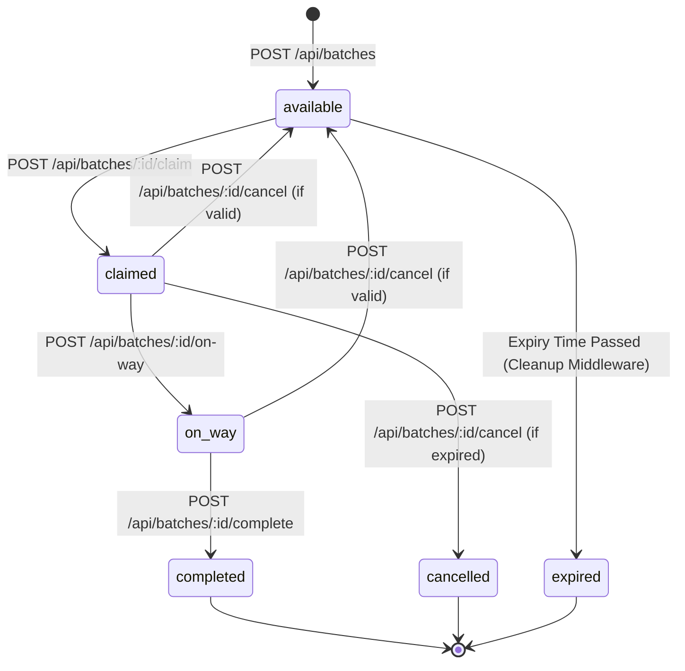

<<<<<<< HEAD
# Food Left at Closing Time

A closing-time surplus food rescue platform connecting restaurants with cooked surplus food to nearby verified shelters and community kitchens before food spoils overnight. Built around the Dhanmondi, Dhaka rescue workflow, the platform replaces late-night phone calls with sub-60-second smart food posting, strict logistical constraint matching, atomic claiming to eliminate double-bookings, reliability tracking with auto-release timers, and 4-digit pickup gate verification codes.

---

## Key Features

- **Sub-60-Second Quick Post (Single-Line Parser):** Restaurants paste or type a casual closing-time note (e.g. `"about 30 plates rice and dal, 2 trays chicken curry, can hold until 11:30pm, pickup from back gate"`) and `parseFoodInput()` automatically extracts `total_portions`, `has_trays`, `hold_until` (capped at `02:00 AM` next morning for food safety), and `pickup_location`.
- **Constraint-Based Shelter Matching:** Automatically filters or blocks claims by:
  - **Cutoff Time:** Prevents shelters past their collection `cutoff_time` (e.g., `22:00` / 10:00 PM) from claiming late batches.
  - **Portion Capacity:** Blocks claims exceeding a shelter's `max_portions` limit (e.g., 50 portions).
  - **Transport & Open-Tray Check:** Blocks shelters without a van (`has_van = 0`, e.g., rickshaw transport) when `has_trays = 1`.
- **Atomic Claiming (`BEGIN IMMEDIATE`):** Wraps claim mutations in an immediate SQLite ACID transaction so concurrent clicks result in exactly one `200 OK` claim and `409 Conflict` for competing shelters.
- **No-Show Protection & 4-Digit Gate Code:** Shelters must confirm departure (`ON_THE_WAY`) within 10 minutes or the batch auto-releases back to `AVAILABLE` with a `-0.5` reliability penalty. Handover requires the 4-digit `gate_code` (`+0.1` reliability, capped at `5.0`).

---

## Tech Stack

- **Frontend (`/frontend`):** React (Vite) + Tailwind CSS (mobile-first, bilingual English/Bangla friendly workflows)
- **Backend (`/backend`):** Node.js (v22.5+ / v24 LTS), Express, `bcryptjs`, `jsonwebtoken`
- **Database:** SQLite via built-in `node:sqlite` (`DatabaseSync` with WAL mode & `BEGIN IMMEDIATE` transactions)

---

## Repository Structure

```text
CapstonProject/
├── .gitignore
├── README.md
├── backend/
│   ├── .env.example
│   ├── package.json
│   ├── server.js                  # Express entrypoint & route mounting
│   ├── seed.js                    # Idempotent demo accounts seed script
│   ├── db/
│   │   └── database.js            # SQLite schema initialization & transaction helper
│   ├── middleware/
│   │   ├── authMiddleware.js      # JWT authentication & role/profile hydration
│   │   └── cleanup.js             # Lazy expiry & 10-min no-show auto-release middleware
│   ├── routes/
│   │   ├── auth.js                # POST /api/auth/register & POST /api/auth/login
│   │   └── batches.js             # POST /api/batches + claim lifecycle endpoints
│   ├── services/
│   │   └── matching.js            # Shelter eligibility & constraint evaluation engine
│   └── utils/
│       └── parser.js              # Natural language closing-time food input parser
└── frontend/
    └── src/
        ├── api/                   # Typed API client & token/polling helpers
        └── pages/                 # Login/Register, Restaurant & Shelter dashboards
=======
# Food Left at Closing Time 🍲⏰

> **SE 331 Software Engineering Capstone Project**  
> Collaborative Group Project for 3 Developers

A specialized full-stack platform designed to eliminate food waste by connecting restaurants, bakeries, cafes, and supermarkets with local charities, shelters, and community members. Food businesses can quickly list edible surplus batches right before closing hours, allowing beneficiaries and volunteer couriers to claim items, signal pickup in real time, and confirm delivery before food spoils.

---

## Table of Contents
1. [Project Overview](#project-overview)
2. [Repository Architecture](#repository-architecture)
3. [Setup & Installation Instructions](#setup--installation-instructions)
   - [Prerequisites](#prerequisites)
   - [Backend Setup](#backend-setup)
   - [Frontend Setup](#frontend-setup)
4. [3-Member Team Branch & File Ownership Rules](#3-member-team-branch--file-ownership-rules)
   - [Branch Naming & Responsibilities](#branch-naming--responsibilities)
   - [File Ownership Matrix](#file-ownership-matrix)
   - [Git Collaboration & Merge Guidelines](#git-collaboration--merge-guidelines)
5. [Exact REST API Contract](#exact-rest-api-contract)
   - [POST /api/auth/register](#1-post-apiauthregister)
   - [POST /api/auth/login](#2-post-apiauthlogin)
   - [POST /api/batches](#3-post-apibatches)
   - [GET /api/batches](#4-get-apibatches)
   - [POST /api/batches/:id/claim](#5-post-apibatchesidclaim)
   - [POST /api/batches/:id/on-way](#6-post-apibatchesidon-way)
   - [POST /api/batches/:id/cancel](#7-post-apibatchesidcancel)
   - [POST /api/batches/:id/complete](#8-post-apibatchesidcomplete)
6. [State Machine Lifecycle](#state-machine-lifecycle)

---

## Project Overview

Every evening, food businesses discard substantial amounts of wholesome, freshly prepared food simply because their retail operating hours have concluded. **Food Left at Closing Time** bridges this operational gap by streamlining:

- **Rapid Batch Listing:** Donors post remaining food with photos, categories, dietary flags, packaging info, and a closing pickup window.
- **Urgent Claim Engine:** Real-time claiming prevents race conditions and ensures items are claimed before closing.
- **Live Transit Status:** Claimers can notify donors that they are "on the way" with estimated arrival times.
- **Automated Expiry Cleanup:** Built-in sweepers monitor time limits and automatically retire uncollected batches.
- **Verification & Handover:** Secure completion mechanisms guarantee accountability and audit tracking.

---

## Repository Architecture

```text
CapstonProject/
├── .gitignore                     # Root gitignore (node_modules, .env, *.sqlite, dist)
├── README.md                      # Project master documentation & API specification
│
├── backend/                       # Express.js REST API & SQLite Database
│   ├── .env.example               # Backend environment variable template
│   ├── package.json               # Backend dependencies & runtime scripts
│   ├── server.js                  # Main Express application entry point
│   ├── seed.js                    # Database schema initialization & mock data [Member 1]
│   ├── db/
│   │   └── database.js            # SQLite database initialization & table setup
│   ├── routes/
│   │   ├── auth.js                # Auth endpoints (register, login stubs) [Member 1]
│   │   └── batches.js             # Batch CRUD & state transitions stubs [Member 2]
│   ├── middleware/
│   │   ├── authMiddleware.js      # JWT authentication middleware { id, role }
│   │   └── cleanup.js             # Expired batch background cleaner hook [Member 2]
│   ├── services/
│   │   └── matching.js            # Donor-to-recipient matching engine [Member 2]
│   └── utils/
│       └── parser.js              # Payload parsing & sanitization helpers [Member 1]
│
└── frontend/                      # React SPA (Vite + Tailwind CSS)
    ├── .env.example               # Frontend environment template
    ├── index.html                 # HTML entry document
    ├── package.json               # Frontend dependencies (react-router-dom, axios, tailwindcss)
    ├── vite.config.js             # Vite config with /api proxy to http://localhost:5000
    ├── tailwind.config.js         # Tailwind CSS styling configuration
    ├── postcss.config.js          # PostCSS configuration with Tailwind & Autoprefixer
    └── src/
        ├── App.jsx                # Protected role-based routing (RESTAURANT / SHELTER)
        ├── main.jsx               # React DOM bootstrapping with Tailwind styles
        ├── index.css              # Tailwind base, components, and utilities
        ├── api/                   # API integration services [Member 3]
        │   ├── client.js          # Pre-configured Axios instance with JWT Bearer interceptor
        │   ├── auth.js            # Auth API callers (login, register)
        │   └── batches.js         # Batch API callers (CRUD & status transitions)
        ├── context/
        │   └── AuthContext.jsx    # Auth state provider (user, token, login, logout)
        └── pages/                 # User interface pages & views [Member 3]
            ├── Auth.jsx           # Login & role-based registration view
            ├── RestaurantDash.jsx # Tanvir's Surplus Posting Dashboard
            └── ShelterFeed.jsx    # Shelter Eligible Batches & Handover PIN entry
>>>>>>> 1f7eb3bb65dbd9dd4386327b8a6aae07a29ebf9b
```

---

<<<<<<< HEAD
## Setup Instructions

### Prerequisites

- **Node.js** `v22.5.0` or higher (`v24` LTS recommended — required for built-in `node:sqlite`)
- **npm** `v10+`
- **Git**

### 1. Backend Setup (`/backend`)

```bash
cd backend
npm install
```

Create `/backend/.env` (you can copy `/backend/.env.example`):

```env
PORT=5000
JWT_SECRET=replace-with-a-strong-secret-key
DB_PATH=./food_rescue.sqlite
CLIENT_URL=http://localhost:5173
```

Seed the pre-configured Dhanmondi demo accounts (idempotent — safe to re-run):

```bash
npm run seed
# or from repo root:
node backend/seed.js
```

Start the backend API server (`http://localhost:5000`):

```bash
npm run dev
```

Verify server health:

```bash
curl http://localhost:5000/api/health
```

### 2. Frontend Setup (`/frontend`)

```bash
cd frontend
npm install
```

Create `/frontend/.env`:

```env
VITE_API_URL=http://localhost:5000/api
```

Start the Vite development server (`http://localhost:5173`):

```bash
npm run dev
```

---

## Pre-Seeded Demo Accounts (Dhanmondi Scenario)

Running `node backend/seed.js` creates/updates the following 4 demo accounts (all use password `password123`):

| Account Name | Email | Password | Role | Key Constraints / Profile |
| :--- | :--- | :--- | :--- | :--- |
| **Tanvir's Restaurant** | `tanvir@dhaka.com` | `password123` | `RESTAURANT` | Address: `Dhanmondi, Dhaka`, Default pickup: `Back gate`, Cutoff: `23:30` |
| **Dhanmondi Van Shelter** | `van@shelter.com` | `password123` | `SHELTER` | `has_van: 1`, `max_portions: 200`, `cutoff_time: 23:59`, Reliability: `4.9` |
| **Early Cutoff Kitchen** | `early@shelter.com` | `password123` | `SHELTER` | `has_van: 0`, `max_portions: 100`, `cutoff_time: 22:00`, Reliability: `4.7` |
| **Small Rickshaw Shelter** | `small@shelter.com` | `password123` | `SHELTER` | `has_van: 0`, `max_portions: 50`, `cutoff_time: 23:59`, Reliability: `4.5` |

---

## 3-Member GitHub Branch & File Ownership Rules

To prevent merge conflicts and keep frontend/backend integration decoupled, each team member owns specific branches and file paths:

| Branch | Owner | Owned Files / Directories | Scope |
| :--- | :--- | :--- | :--- |
| `feat/backend-core` | **Member 1** | `/backend/routes/auth.js`<br>`/backend/utils/parser.js`<br>`/backend/seed.js` | Auth registration/login, natural-language food parser, idempotent demo seed script, and `POST /api/batches` creation handler |
| `feat/claim-engine` | **Member 2** | `/backend/routes/batches.js`<br>`/backend/middleware/cleanup.js`<br>`/backend/services/matching.js` | Constraint matching engine, lazy no-show auto-release middleware, `GET /api/batches`, and atomic claim/on-way/cancel/complete handlers |
| `feat/frontend-ui` | **Member 3** | `/frontend/src/pages/*`<br>`/frontend/src/api/*` | API client wrappers, top demo account switcher, Restaurant Quick-Post dashboard, and Shelter live eligibility feed |

### Collaboration Rules

1. **Strict File Ownership:** Never modify files owned by another member inside your feature branch.
   - Example: Member 1 creates `POST /api/batches` cleanly inside `/backend/routes/batches.js` while leaving Member 2's `GET /`, `/:id/claim`, `/:id/on-way`, `/:id/cancel`, and `/:id/complete` stubs untouched.
2. **Shared Infrastructure Changes:** Edits to root `README.md`, `.gitignore`, `/backend/server.js`, `/backend/db/database.js`, or `package.json` must be coordinated via small, agreed PRs before merging feature branches.
3. **Contract-First Integration:** All frontend requests and backend handlers must strictly conform to the REST API contract documented below.
4. **Branch Workflow:**
   ```bash
   git checkout -b feat/<your-branch>
   # Implement only your owned files, then push and open a PR
=======
## Setup & Installation Instructions

### Prerequisites
- **Node.js**: `v18.x` or higher (verify via `node -v`)
- **npm**: `v9.x` or higher (verify via `npm -v`)
- **Git**: Installed and configured with your GitHub credentials

---

### Backend Setup

1. **Navigate to the backend directory:**
   ```bash
   cd backend
   ```

2. **Install dependencies:**
   ```bash
   npm install
   ```

3. **Configure environment variables:**
   ```bash
   # Copy the sample environment file
   cp .env.example .env
   ```
   *Default `.env` values:*
   ```env
   PORT=5000
   NODE_ENV=development
   JWT_SECRET=super_secret_jwt_key_change_in_production
   DB_PATH=./database.sqlite
   CORS_ORIGIN=http://localhost:5173
   BATCH_CLEANUP_INTERVAL_MS=300000
   ```

4. **Initialize and seed the database:**
   ```bash
   npm run seed
   ```

5. **Start the backend development server:**
   ```bash
   npm run dev
   ```
   The backend will start at: `http://localhost:5000`  
   Health check endpoint: `http://localhost:5000/api/health`

---

### Frontend Setup

1. **Navigate to the frontend directory:**
   ```bash
   cd frontend
   ```

2. **Install dependencies:**
   ```bash
   npm install
   ```

3. **Configure environment variables:**
   ```bash
   # Copy the sample environment file
   cp .env.example .env
   ```
   *Default `.env` values:*
   ```env
   VITE_API_BASE_URL=http://localhost:5000/api
   ```

4. **Start the frontend development server:**
   ```bash
   npm run dev
   ```
   The application UI will be accessible at: `http://localhost:5173`

5. **Build for production:**
   ```bash
   npm run build
>>>>>>> 1f7eb3bb65dbd9dd4386327b8a6aae07a29ebf9b
   ```

---

<<<<<<< HEAD
## Shared SQLite Schema Reference

| Table | Key Columns |
| :--- | :--- |
| `users` | `id`, `name`, `email` (unique), `password_hash`, `role` (`RESTAURANT` \| `SHELTER`), `phone`, `address`, `default_pickup_point`, `closing_cutoff_time`, `created_at` |
| `shelter_profiles` | `id`, `user_id` (unique FK -> `users.id`), `has_van` (`0` \| `1`), `max_portions`, `cutoff_time` (`HH:MM`), `reliability_score` (`0.0–5.0`), `no_show_count`, `updated_at` |
| `food_batches` | `id`, `restaurant_id` (FK -> `users.id`), `raw_description`, `total_portions`, `has_trays` (`0` \| `1`), `pickup_location`, `hold_until` (ISO-8601), `gate_code` (4-digit string), `status` (`AVAILABLE` \| `CLAIMED` \| `ON_THE_WAY` \| `COMPLETED` \| `EXPIRED`), `claimed_by_shelter_id`, `claimed_at`, `claim_expires_at`, `on_way_at`, `arrived_at`, `eta_minutes`, `priority_release_at`, `completed_at`, `created_at` |
| `no_show_logs` | `id`, `batch_id` (FK -> `food_batches.id`), `shelter_id` (FK -> `users.id`), `reason`, `penalty_applied`, `created_at` |
=======
## 3-Member Team Branch & File Ownership Rules

To prevent code collisions and git merge conflicts in our 3-developer team, we enforce strict **file ownership boundaries** and **dedicated feature branches**.

### Branch Naming & Responsibilities

| Role | Branch Name | Developer | Core Domain Focus |
| :--- | :--- | :--- | :--- |
| **Member 1** | `feat/backend-core` | Developer 1 | Authentication, user tokens, input parser utilities, database schema, and test seeds. |
| **Member 2** | `feat/claim-engine` | Developer 2 | Food batch state machine, claiming workflow, expiration background sweep, matching algorithms. |
| **Member 3** | `feat/frontend-ui` | Developer 3 | Client UI pages, responsive layout, form validations, and API communication layer. |

---

### File Ownership Matrix

```
┌───────────────────────────────┬────────────────────────────────────────────────────────┐
│ Branch / Member               │ Exclusive File Ownership                               │
├───────────────────────────────┼────────────────────────────────────────────────────────┤
│ Member 1                      │ • /backend/routes/auth.js                              │
│ feat/backend-core             │ • /backend/utils/parser.js                             │
│                               │ • /backend/seed.js                                     │
├───────────────────────────────┼────────────────────────────────────────────────────────┤
│ Member 2                      │ • /backend/routes/batches.js                           │
│ feat/claim-engine             │ • /backend/middleware/cleanup.js                       │
│                               │ • /backend/services/matching.js                        │
├───────────────────────────────┼────────────────────────────────────────────────────────┤
│ Member 3                      │ • /frontend/src/pages/* (All UI views)                 │
│ feat/frontend-ui              │ • /frontend/src/api/* (All API client integrations)    │
└───────────────────────────────┴────────────────────────────────────────────────────────┘
```

> ⚠️ **RULE**: Never modify files owned by another member without explicit verbal confirmation and a peer code review.

---

### Git Collaboration & Merge Guidelines

1. **Branch Creation:**  
   Every developer starts their feature branch from the latest `main`:
   ```bash
   git checkout main
   git pull origin main
   git checkout -b <your-branch-name>
   ```

2. **Commit Conventions:**  
   Write clean, descriptive commit messages matching conventional commits:
   - `feat: add password hashing in auth route`
   - `fix: handle expired batch transition on claim`
   - `ui: style batch card status pills`

3. **Pull Request (PR) Policy:**
   - **No direct commits to `main`**. All code changes must go through a GitHub Pull Request.
   - At least **1 peer review approval** is required before merging.
   - Run tests and verify both backend and frontend compile locally before creating a PR.
   - Always pull latest `main` into your feature branch before requesting review:
     ```bash
     git checkout main
     git pull origin main
     git checkout <your-branch-name>
     git merge main
     ```
>>>>>>> 1f7eb3bb65dbd9dd4386327b8a6aae07a29ebf9b

---

## Exact REST API Contract

<<<<<<< HEAD
- **Base URL:** `http://localhost:5000/api`
- **Headers:** `Content-Type: application/json` (plus `Authorization: Bearer <jwt_token>` on all protected routes)
- **Standard Error Envelope:**
  ```json
  {
    "error": "Human-readable error description",
    "code": "MACHINE_READABLE_ERROR_CODE"
  }
  ```
- **Batch Status Lifecycle:** `AVAILABLE` → `CLAIMED` → `ON_THE_WAY` → `COMPLETED` (or auto-released/cancelled back to `AVAILABLE` / `EXPIRED`)

---

### 1. Authentication

#### `POST /api/auth/register`

Register a new `RESTAURANT` or `SHELTER` user. Shelter accounts must include `has_van`, `max_portions`, and `cutoff_time`, which are written to `shelter_profiles` inside the same database transaction.

- **Auth:** Public
- **Request JSON (Restaurant):**
  ```json
  {
    "name": "Tanvir's Restaurant",
    "email": "tanvir@dhaka.com",
    "password": "password123",
    "role": "RESTAURANT",
    "phone": "+8801711000101",
    "address": "House 14, Road 6, Dhanmondi, Dhaka",
    "default_pickup_point": "Back gate",
    "closing_cutoff_time": "23:30"
  }
  ```
- **Request JSON (Shelter):**
  ```json
  {
    "name": "Dhanmondi Van Shelter",
    "email": "van@shelter.com",
    "password": "password123",
    "role": "SHELTER",
    "phone": "+8801711000201",
    "address": "Road 9/A, Dhanmondi, Dhaka",
    "has_van": true,
    "max_portions": 200,
    "cutoff_time": "23:59"
  }
  ```
- **Response JSON (`201 Created`):**
  ```json
  {
    "token": "eyJhbGciOiJIUzI1NiIsInR5cCI6IkpXVCJ9...",
    "user": {
      "id": 2,
      "name": "Dhanmondi Van Shelter",
      "email": "van@shelter.com",
      "role": "SHELTER",
      "phone": "+8801711000201",
      "address": "Road 9/A, Dhanmondi, Dhaka",
      "default_pickup_point": "Back gate",
      "closing_cutoff_time": "23:30",
      "shelter_profile": {
        "id": 1,
        "user_id": 2,
        "has_van": 1,
        "max_portions": 200,
        "cutoff_time": "23:59",
        "reliability_score": 5.0,
        "no_show_count": 0,
        "updated_at": "2026-11-23 06:00:00"
      }
    }
  }
  ```
- **Error Responses:**
  - `400 Bad Request` (`VALIDATION_ERROR`): Missing, invalid, or fake placeholder input fields.
  - `409 Conflict` (`EMAIL_EXISTS`): Email is already registered.

---

#### `POST /api/auth/login`

Authenticate an existing user and return a signed JWT along with their profile (`shelter_profile` is `null` for restaurants).

- **Auth:** Public
- **Request JSON:**
  ```json
  {
    "email": "van@shelter.com",
    "password": "password123"
  }
  ```
- **Response JSON (`200 OK`):**
  ```json
  {
    "token": "eyJhbGciOiJIUzI1NiIsInR5cCI6IkpXVCJ9...",
    "user": {
      "id": 2,
      "name": "Dhanmondi Van Shelter",
      "email": "van@shelter.com",
      "role": "SHELTER",
      "phone": "+8801711000201",
      "address": "Road 9/A, Dhanmondi, Dhaka",
      "default_pickup_point": "Main gate",
      "closing_cutoff_time": "23:59",
      "shelter_profile": {
        "id": 1,
        "user_id": 2,
        "has_van": 1,
        "max_portions": 200,
        "cutoff_time": "23:59",
        "reliability_score": 4.9,
        "no_show_count": 0,
        "updated_at": "2026-11-23 06:00:00"
      }
    }
  }
  ```
- **Error Responses:**
  - `400 Bad Request` (`VALIDATION_ERROR`): Missing `email` or `password`.
  - `401 Unauthorized` (`INVALID_CREDENTIALS`): Invalid email or password.

---

### 2. Surplus Batch Creation & Feed

#### `POST /api/batches`

Create a surplus food batch as a `RESTAURANT`. Any omitted structured fields (`total_portions`, `has_trays`, `pickup_location`, `hold_until`) are automatically extracted from `raw_description` via `parseFoodInput()`, with food-safety capping at `02:00 AM` next morning and a generated 4-digit `gate_code`.

- **Auth:** Required (`RESTAURANT` only)
- **Request JSON:**
  ```json
  {
    "raw_description": "about 30 plates rice and dal, 2 trays chicken curry, can hold until 11:30pm, pickup from back gate",
    "total_portions": 30,
    "has_trays": 1,
    "pickup_location": "Back gate",
    "hold_until": "2026-11-23T17:30:00.000Z"
  }
  ```
  *(All fields except `raw_description` are optional; if omitted, the parser populates them.)*
- **Response JSON (`201 Created`):**
  ```json
  {
    "batch": {
      "id": 1,
      "restaurant_id": 1,
      "restaurant_name": "Tanvir's Restaurant",
      "restaurant_address": "Dhanmondi, Dhaka",
      "restaurant_phone": "+8801711000101",
      "raw_description": "about 30 plates rice and dal, 2 trays chicken curry, can hold until 11:30pm, pickup from back gate",
      "total_portions": 30,
      "has_trays": 1,
      "pickup_location": "Back gate",
      "hold_until": "2026-11-23T17:30:00.000Z",
      "gate_code": "4829",
      "status": "AVAILABLE",
      "claimed_by_shelter_id": null,
      "claimed_at": null,
      "claim_expires_at": null,
      "on_way_at": null,
      "arrived_at": null,
      "eta_minutes": null,
      "priority_release_at": "2026-11-23T06:03:00.000Z",
      "completed_at": null,
      "created_at": "2026-11-23T06:00:00.000Z"
    }
  }
  ```
- **Error Responses:**
  - `400 Bad Request` (`VALIDATION_ERROR`): Missing/short `raw_description` or malformed override field.
  - `401 Unauthorized` (`UNAUTHORIZED` / `INVALID_TOKEN`): Missing or invalid JWT.
  - `403 Forbidden` (`FORBIDDEN`): Authenticated user has role `SHELTER`.

---

#### `GET /api/batches`

Runs `cleanupExpiredClaims` first to auto-release expired 10-minute claims and expire overdue batches, then returns batches scoped to the caller's role. Shelters receive constraint eligibility metadata (`eligibility`) per batch and only see `gate_code` on batches they claimed.

- **Auth:** Required (`RESTAURANT` or `SHELTER`)
- **Optional Query Params:** `?status=AVAILABLE` | `?simulated_time=2026-11-23T22:30:00+06:00` (for demo cutoff/timeout testing)
- **Request JSON:** None
- **Response JSON (`200 OK` — Shelter View):**
  ```json
  {
    "server_time": "2026-11-23T16:15:00.000Z",
    "batches": [
      {
        "id": 1,
        "restaurant_id": 1,
        "restaurant_name": "Tanvir's Restaurant",
        "restaurant_address": "Dhanmondi, Dhaka",
        "raw_description": "about 30 plates rice and dal, 2 trays chicken curry, can hold until 11:30pm, pickup from back gate",
        "total_portions": 30,
        "has_trays": 1,
        "pickup_location": "Back gate",
        "hold_until": "2026-11-23T17:30:00.000Z",
        "status": "AVAILABLE",
        "gate_code": null,
        "claimed_by_shelter_id": null,
        "priority_release_at": "2026-11-23T06:03:00.000Z",
        "created_at": "2026-11-23T06:00:00.000Z",
        "eligibility": {
          "can_claim": false,
          "status": "BLOCKED",
          "reasons": [
            {
              "code": "REQUIRES_VAN_TRAYS",
              "label": "Requires Van / Cannot transport open trays",
              "detail": "Batch contains open trays (has_trays = 1) and requires has_van = 1."
            }
          ],
          "priority_hold_seconds": 0,
          "available_at": "2026-11-23T06:00:00.000Z"
        }
      }
    ]
  }
  ```
- **Response JSON (`200 OK` — Restaurant View):**
  ```json
  {
    "server_time": "2026-11-23T16:15:00.000Z",
    "batches": [
      {
        "id": 1,
        "restaurant_id": 1,
        "raw_description": "about 30 plates rice and dal, 2 trays chicken curry, can hold until 11:30pm, pickup from back gate",
        "total_portions": 30,
        "has_trays": 1,
        "pickup_location": "Back gate",
        "hold_until": "2026-11-23T17:30:00.000Z",
        "gate_code": "4829",
        "status": "CLAIMED",
        "claimed_by_shelter_id": 2,
        "claimed_by_shelter_name": "Dhanmondi Van Shelter",
        "claimed_by_reliability_score": 4.9,
        "claimed_at": "2026-11-23T16:10:00.000Z",
        "claim_expires_at": "2026-11-23T16:20:00.000Z",
        "on_way_at": null,
        "arrived_at": null,
        "eta_minutes": 15,
        "completed_at": null,
        "created_at": "2026-11-23T16:00:00.000Z"
      }
    ]
  }
  ```
- **Error Responses:**
  - `401 Unauthorized` (`UNAUTHORIZED` / `INVALID_TOKEN`)

---

### 3. Atomic Claim & Rescue Lifecycle

#### `POST /api/batches/:id/claim`

Atomically claims an `AVAILABLE` batch for the authenticated `SHELTER` inside a `BEGIN IMMEDIATE` transaction after re-verifying cutoff, capacity, van/tray compatibility, and 3-minute priority hold rules. Sets a 10-minute departure deadline (`claim_expires_at`) and reveals `gate_code` to the claiming shelter.

- **Auth:** Required (`SHELTER` only)
- **Request JSON:**
  ```json
  {
    "eta_minutes": 15,
    "demo_fast_forward": false
  }
  ```
- **Response JSON (`200 OK`):**
  ```json
  {
    "batch": {
      "id": 1,
      "status": "CLAIMED",
      "claimed_by_shelter_id": 2,
      "claimed_at": "2026-11-23T16:10:00.000Z",
      "claim_expires_at": "2026-11-23T16:20:00.000Z",
      "eta_minutes": 15,
      "gate_code": "4829",
      "pickup_location": "Back gate",
      "hold_until": "2026-11-23T17:30:00.000Z"
    }
  }
  ```
- **Error Responses:**
  - `403 Forbidden` (`CONSTRAINT_BLOCKED` / `PRIORITY_HOLD` / `FORBIDDEN`): Shelter fails cutoff/capacity/van check or is in low-reliability priority hold.
  - `404 Not Found` (`BATCH_NOT_FOUND`): Batch does not exist.
  - `409 Conflict` (`ALREADY_CLAIMED` / `BATCH_UNAVAILABLE`): Concurrent shelter already claimed the batch or batch expired.

---

#### `POST /api/batches/:id/on-way`

Confirms the claiming shelter is en route (must be triggered within 10 minutes of `claimed_at`, cancelling the departure no-show timer) or updates arrival status at the pickup gate.

- **Auth:** Required (claiming `SHELTER` only)
- **Request JSON:**
  ```json
  {
    "eta_minutes": 10,
    "arrived": false
  }
  ```
- **Response JSON (`200 OK`):**
  ```json
  {
    "batch": {
      "id": 1,
      "status": "ON_THE_WAY",
      "claimed_by_shelter_id": 2,
      "on_way_at": "2026-11-23T16:13:00.000Z",
      "arrived_at": null,
      "eta_minutes": 10
    }
  }
  ```
- **Error Responses:**
  - `403 Forbidden` (`FORBIDDEN`): Caller is not the claiming shelter.
  - `404 Not Found` (`BATCH_NOT_FOUND`): Batch does not exist.
  - `409 Conflict` (`CLAIM_EXPIRED` / `INVALID_STATE`): Claim expired (`> 10` minutes) or batch is not in `CLAIMED` / `ON_THE_WAY` state.

---

#### `POST /api/batches/:id/cancel`

Releases an active `CLAIMED` or `ON_THE_WAY` batch back to `AVAILABLE` (or `EXPIRED` if past `hold_until`). Supports voluntary cancellation (`is_no_show: false`, no reliability penalty) as well as flagging a no-show / simulating timeout (`is_no_show: true`, deducting `0.5` from `reliability_score` floored at `0.0` and incrementing `no_show_count`).

- **Auth:** Required (owning `RESTAURANT` or claiming `SHELTER`)
- **Request JSON:**
  ```json
  {
    "reason": "NO_SHOW_TIMEOUT",
    "is_no_show": true
  }
  ```
- **Response JSON (`200 OK`):**
  ```json
  {
    "batch": {
      "id": 1,
      "status": "AVAILABLE",
      "claimed_by_shelter_id": null,
      "claimed_at": null,
      "claim_expires_at": null,
      "on_way_at": null,
      "arrived_at": null,
      "eta_minutes": null
    },
    "penalty_applied": 0.5,
    "shelter_reliability_score": 4.4
  }
  ```
- **Error Responses:**
  - `403 Forbidden` (`FORBIDDEN`): Caller neither owns the batch nor holds the claim.
  - `404 Not Found` (`BATCH_NOT_FOUND`): Batch does not exist.
  - `409 Conflict` (`INVALID_STATE`): Batch is already `COMPLETED`, `EXPIRED`, or `AVAILABLE`.

---

#### `POST /api/batches/:id/complete`

Verifies handover at the pickup point using the 4-digit `gate_code`, transitions the batch to `COMPLETED`, and rewards the collecting shelter with `+0.1` `reliability_score` (capped at `5.0`).

- **Auth:** Required (owning `RESTAURANT` only)
- **Request JSON:**
  ```json
  {
    "gate_code": "4829"
  }
  ```
- **Response JSON (`200 OK`):**
  ```json
  {
    "batch": {
      "id": 1,
      "status": "COMPLETED",
      "claimed_by_shelter_id": 2,
      "completed_at": "2026-11-23T16:28:00.000Z"
    },
    "shelter_reliability_score": 5.0
  }
  ```
- **Error Responses:**
  - `400 Bad Request` (`INVALID_GATE_CODE`): Provided `gate_code` does not match the batch's 4-digit code.
  - `403 Forbidden` (`FORBIDDEN`): Authenticated user is not the owning restaurant.
  - `404 Not Found` (`BATCH_NOT_FOUND`): Batch does not exist.
  - `409 Conflict` (`INVALID_STATE`): Batch is not currently `CLAIMED` or `ON_THE_WAY`.

---

## Testing Guide (End-to-End Scenarios)

1. **Sub-60s Quick Post:** Log in as `tanvir@dhaka.com` (`password123`) and `POST /api/batches` with `{ "raw_description": "about 30 plates rice and dal, 2 trays chicken curry, can hold until 11:30pm, pickup from back gate" }` — verify `total_portions = 30`, `has_trays = 1`, `pickup_location = "Back gate"`, and a 4-digit `gate_code`.
2. **Constraint Filtering:** Fetch `GET /api/batches` using `van@shelter.com` (eligible), `early@shelter.com` (blocked past `22:00` cutoff and/or `has_trays = 1`), and `small@shelter.com` (blocked on `has_trays = 1` or `total_portions > 50`).
3. **Concurrent Double-Claim Prevention:** Send two parallel `POST /api/batches/:id/claim` requests for the same batch — verify one returns `200 OK` and the second returns `409 Conflict`.
4. **No-Show Auto-Release & Handover:** Trigger `POST /api/batches/:id/cancel` with `is_no_show: true` (or let the 10-minute `claim_expires_at` elapse) to verify `-0.5` reliability deduction and batch return to `AVAILABLE`; then claim and verify handover via `POST /api/batches/:id/complete` with `gate_code` for `+0.1` reliability reward.
=======
Base URL: `http://localhost:5000/api`

---

### 1. POST /api/auth/register

Registers a new user (donor business, recipient shelter/charity, or volunteer courier).

- **Method:** `POST`
- **URL:** `/api/auth/register`
- **Authentication:** Public (None)
- **Headers:** `Content-Type: application/json`

#### Request JSON
```json
{
  "name": "Downtown Bakery & Cafe",
  "email": "contact@downtownbakery.com",
  "password": "SecurePassword123!",
  "role": "donor",
  "phone": "+1-555-0199",
  "organization": "Downtown Bakery LLC"
}
```
*Field Specifications:*
- `name` *(string, required)*: Full name or business name.
- `email` *(string, required)*: Valid unique email address.
- `password` *(string, required)*: Plaintext password (minimum 8 chars).
- `role` *(string, required)*: One of `donor`, `recipient`, `volunteer`.
- `phone` *(string, optional)*: Contact telephone number.
- `organization` *(string, optional)*: Registered company / charity entity.

#### Response JSON
- **Success (201 Created):**
```json
{
  "message": "User registered successfully",
  "user": {
    "id": "usr_948194821",
    "name": "Downtown Bakery & Cafe",
    "email": "contact@downtownbakery.com",
    "role": "donor",
    "phone": "+1-555-0199",
    "organization": "Downtown Bakery LLC",
    "createdAt": "2026-11-23T11:30:00.000Z"
  },
  "token": "eyJhbGciOiJIUzI1NiIsInR5cCI6IkpXVCJ9.eyJpZCI6InVzcl85NDgxOTQ4MjEiLCJyb2xlIjoiZG9ub3IifQ..."
}
```

- **Error (400 Bad Request):**
```json
{
  "error": "Missing required fields: name, email, password, and role are mandatory."
}
```

- **Error (409 Conflict):**
```json
{
  "error": "User with this email already exists."
}
```

---

### 2. POST /api/auth/login

Authenticates an existing user and returns a signed JWT bearer token.

- **Method:** `POST`
- **URL:** `/api/auth/login`
- **Authentication:** Public (None)
- **Headers:** `Content-Type: application/json`

#### Request JSON
```json
{
  "email": "contact@downtownbakery.com",
  "password": "SecurePassword123!"
}
```

#### Response JSON
- **Success (200 OK):**
```json
{
  "message": "Login successful",
  "token": "eyJhbGciOiJIUzI1NiIsInR5cCI6IkpXVCJ9.eyJpZCI6InVzcl85NDgxOTQ4MjEiLCJyb2xlIjoiZG9ub3IifQ...",
  "user": {
    "id": "usr_948194821",
    "name": "Downtown Bakery & Cafe",
    "email": "contact@downtownbakery.com",
    "role": "donor",
    "organization": "Downtown Bakery LLC"
  }
}
```

- **Error (401 Unauthorized):**
```json
{
  "error": "Invalid email or password."
}
```

---

### 3. POST /api/batches

Allows a food business (donor) to create a surplus food batch available for pickup at closing time.

- **Method:** `POST`
- **URL:** `/api/batches`
- **Authentication:** Bearer Token (`Authorization: Bearer <token>`)
- **Headers:**
  - `Content-Type: application/json`
  - `Authorization: Bearer <token>`

#### Request JSON
```json
{
  "title": "Fresh Pastries & Whole Wheat Loaves",
  "description": "12 croissants, 8 cinnamon rolls, and 5 fresh sourdough loaves baked this morning. Boxed and ready for pickup.",
  "category": "bakery",
  "quantity": 25,
  "unit": "portions",
  "expiryTime": "2026-11-23T21:00:00.000Z",
  "pickupAddress": "124 Market Street, Suite 100, City Center",
  "allergens": ["gluten", "dairy"],
  "dietaryFlags": ["vegetarian"]
}
```
*Field Specifications:*
- `title` *(string, required)*: Brief headline of the surplus food.
- `description` *(string, optional)*: Details about packaging, heating instructions, or specific contents.
- `category` *(string, required)*: One of `bakery`, `prepared_meals`, `produce`, `dairy`, `groceries`, `other`.
- `quantity` *(number, required)*: Positive integer amount.
- `unit` *(string, required)*: Unit denomination (`items`, `portions`, `boxes`, `kg`).
- `expiryTime` *(ISO8601 string, required)*: Closing/cutoff time after which food cannot be collected.
- `pickupAddress` *(string, required)*: Location where items can be picked up.
- `allergens` *(array of strings, optional)*: e.g. `["nuts", "dairy"]`.
- `dietaryFlags` *(array of strings, optional)*: e.g. `["halal", "vegan"]`.

#### Response JSON
- **Success (201 Created):**
```json
{
  "message": "Food batch posted successfully",
  "batch": {
    "id": "batch_820491823",
    "title": "Fresh Pastries & Whole Wheat Loaves",
    "description": "12 croissants, 8 cinnamon rolls, and 5 fresh sourdough loaves baked this morning. Boxed and ready for pickup.",
    "category": "bakery",
    "quantity": 25,
    "unit": "portions",
    "status": "available",
    "donorId": "usr_948194821",
    "claimedBy": null,
    "claimedAt": null,
    "pickupAddress": "124 Market Street, Suite 100, City Center",
    "allergens": ["gluten", "dairy"],
    "dietaryFlags": ["vegetarian"],
    "expiryTime": "2026-11-23T21:00:00.000Z",
    "createdAt": "2026-11-23T18:30:00.000Z",
    "updatedAt": "2026-11-23T18:30:00.000Z"
  }
}
```

- **Error (400 Bad Request):**
```json
{
  "error": "Missing required batch fields: title, quantity, expiryTime, and pickupAddress are required."
}
```

- **Error (401 Unauthorized):**
```json
{
  "error": "Authentication token missing or invalid."
}
```

---

### 4. GET /api/batches

Fetches a list of food batches with optional query parameter filtering.

- **Method:** `GET`
- **URL:** `/api/batches`
- **Authentication:** Public or Authenticated
- **Query Parameters:**
  - `status` *(string, optional)*: Filter by batch state (`available`, `claimed`, `on-way`, `completed`, `expired`).
  - `category` *(string, optional)*: Filter by food category (`bakery`, `produce`, etc.).
  - `donorId` *(string, optional)*: Filter by donor user ID.

#### Request Example
```http
GET /api/batches?status=available&category=bakery HTTP/1.1
Host: localhost:5000
```

#### Response JSON
- **Success (200 OK):**
```json
{
  "total": 2,
  "batches": [
    {
      "id": "batch_820491823",
      "title": "Fresh Pastries & Whole Wheat Loaves",
      "description": "12 croissants, 8 cinnamon rolls, and 5 fresh sourdough loaves.",
      "category": "bakery",
      "quantity": 25,
      "unit": "portions",
      "status": "available",
      "donorId": "usr_948194821",
      "claimedBy": null,
      "claimedAt": null,
      "pickupAddress": "124 Market Street, Suite 100, City Center",
      "allergens": ["gluten", "dairy"],
      "dietaryFlags": ["vegetarian"],
      "expiryTime": "2026-11-23T21:00:00.000Z",
      "createdAt": "2026-11-23T18:30:00.000Z",
      "updatedAt": "2026-11-23T18:30:00.000Z"
    },
    {
      "id": "batch_101",
      "title": "Artisan Sourdough and Baguettes",
      "description": "15 freshly baked sourdough loaves and 10 baguettes remaining after closing.",
      "category": "bakery",
      "quantity": 25,
      "unit": "loaves",
      "status": "available",
      "donorId": "usr_donor_1",
      "claimedBy": null,
      "claimedAt": null,
      "pickupAddress": "124 Market St, City Center",
      "allergens": ["gluten"],
      "dietaryFlags": ["vegan"],
      "expiryTime": "2026-11-23T22:00:00.000Z",
      "createdAt": "2026-11-23T18:00:00.000Z",
      "updatedAt": "2026-11-23T18:00:00.000Z"
    }
  ]
}
```

---

### 5. POST /api/batches/:id/claim

Allows a recipient or volunteer to reserve an available food batch before pickup.

- **Method:** `POST`
- **URL:** `/api/batches/:id/claim`
- **Authentication:** Bearer Token (`Authorization: Bearer <token>`)
- **Headers:**
  - `Content-Type: application/json`
  - `Authorization: Bearer <token>`
- **URL Parameters:** `id` (e.g. `batch_820491823`)

#### Request JSON
```json
{
  "claimNotes": "Volunteer driver dispatched from Westside community center.",
  "estimatedPickupTime": "2026-11-23T20:15:00.000Z"
}
```

#### Response JSON
- **Success (200 OK):**
```json
{
  "message": "Batch successfully claimed",
  "batch": {
    "id": "batch_820491823",
    "title": "Fresh Pastries & Whole Wheat Loaves",
    "status": "claimed",
    "donorId": "usr_948194821",
    "claimedBy": "usr_recipient_452",
    "claimedAt": "2026-11-23T19:00:00.000Z",
    "claimNotes": "Volunteer driver dispatched from Westside community center.",
    "estimatedPickupTime": "2026-11-23T20:15:00.000Z",
    "updatedAt": "2026-11-23T19:00:00.000Z"
  }
}
```

- **Error (400 Bad Request - Already Claimed):**
```json
{
  "error": "Batch cannot be claimed. Current status is 'claimed'."
}
```

- **Error (400 Bad Request - Expired):**
```json
{
  "error": "Batch has expired and can no longer be claimed."
}
```

- **Error (404 Not Found):**
```json
{
  "error": "Batch not found."
}
```

---

### 6. POST /api/batches/:id/on-way

Signals that the claimant/driver is actively in transit to the closing business for collection.

- **Method:** `POST`
- **URL:** `/api/batches/:id/on-way`
- **Authentication:** Bearer Token (`Authorization: Bearer <token>`)
- **Headers:**
  - `Content-Type: application/json`
  - `Authorization: Bearer <token>`
- **URL Parameters:** `id`

#### Request JSON
```json
{
  "currentLocation": "5th Avenue & Pine St",
  "etaMinutes": 15
}
```

#### Response JSON
- **Success (200 OK):**
```json
{
  "message": "Status updated: Claimer is on the way for pickup",
  "batch": {
    "id": "batch_820491823",
    "title": "Fresh Pastries & Whole Wheat Loaves",
    "status": "on-way",
    "donorId": "usr_948194821",
    "claimedBy": "usr_recipient_452",
    "transitInfo": {
      "currentLocation": "5th Avenue & Pine St",
      "etaMinutes": 15,
      "updatedAt": "2026-11-23T19:30:00.000Z"
    },
    "updatedAt": "2026-11-23T19:30:00.000Z"
  }
}
```

- **Error (400 Bad Request - Invalid State Transition):**
```json
{
  "error": "Invalid transition. Batch must be in 'claimed' status before transitioning to 'on-way'. Current status: 'available'."
}
```

- **Error (404 Not Found):**
```json
{
  "error": "Batch not found."
}
```

---

### 7. POST /api/batches/:id/cancel

Allows the claimer or donor to cancel an active claim, releasing the batch back to `available` if within the pickup window, or marking it `cancelled`.

- **Method:** `POST`
- **URL:** `/api/batches/:id/cancel`
- **Authentication:** Bearer Token (`Authorization: Bearer <token>`)
- **Headers:**
  - `Content-Type: application/json`
  - `Authorization: Bearer <token>`
- **URL Parameters:** `id`

#### Request JSON
```json
{
  "reason": "Courier vehicle experienced a flat tire; unable to arrive before closing."
}
```

#### Response JSON
- **Success (200 OK - Restored to Available):**
```json
{
  "message": "Batch status changed from 'claimed' to 'available'",
  "batch": {
    "id": "batch_820491823",
    "title": "Fresh Pastries & Whole Wheat Loaves",
    "status": "available",
    "claimedBy": null,
    "claimedAt": null,
    "cancellationReason": "Courier vehicle experienced a flat tire; unable to arrive before closing.",
    "updatedAt": "2026-11-23T19:40:00.000Z"
  }
}
```

- **Error (400 Bad Request):**
```json
{
  "error": "Cannot cancel a batch that is already completed."
}
```

- **Error (404 Not Found):**
```json
{
  "error": "Batch not found."
}
```

---

### 8. POST /api/batches/:id/complete

Finalizes the food rescue lifecycle once the batch has been handed over at closing time.

- **Method:** `POST`
- **URL:** `/api/batches/:id/complete`
- **Authentication:** Bearer Token (`Authorization: Bearer <token>`)
- **Headers:**
  - `Content-Type: application/json`
  - `Authorization: Bearer <token>`
- **URL Parameters:** `id`

#### Request JSON
```json
{
  "receivedQuantity": 25,
  "confirmationCode": "PICKUP-8921",
  "notes": "All pastries and loaves received in excellent condition and temperature."
}
```

#### Response JSON
- **Success (200 OK):**
```json
{
  "message": "Batch pickup completed successfully. Food rescue verified!",
  "batch": {
    "id": "batch_820491823",
    "title": "Fresh Pastries & Whole Wheat Loaves",
    "status": "completed",
    "completedAt": "2026-11-23T20:10:00.000Z",
    "completionDetails": {
      "receivedQuantity": 25,
      "confirmationCode": "PICKUP-8921",
      "notes": "All pastries and loaves received in excellent condition and temperature."
    },
    "updatedAt": "2026-11-23T20:10:00.000Z"
  }
}
```

- **Error (400 Bad Request):**
```json
{
  "error": "Cannot complete batch from current status 'available'. Batch must be 'claimed' or 'on-way'."
}
```

- **Error (404 Not Found):**
```json
{
  "error": "Batch not found."
}
```

---

## State Machine Lifecycle



---

## Contributing & License
- Course: **SE 331 Software Engineering Capstone Project**
- Team Members: 3 Developers
- License: MIT License (Academic Use)
>>>>>>> 1f7eb3bb65dbd9dd4386327b8a6aae07a29ebf9b
